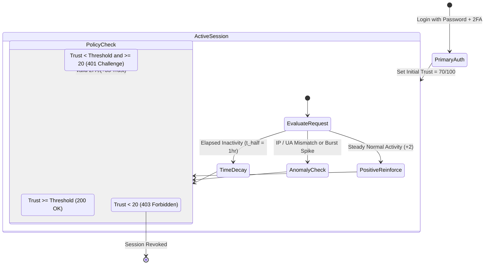

# Continuous Adaptive Risk and Trust Assessment (CARTA) Platform
### Dynamic Zero-Trust Session Evaluation Engine & Reverse Proxy Gate

This project implements a **Continuous Adaptive Risk and Trust Assessment (CARTA)** system—the core paradigm powering modern **Zero-Trust Network Architecture (ZTNA)**. 

Unlike traditional perimeter security where authentication happens once at login, this system **continuously evaluates trust on every single click/request**, dynamically adapting to time decay, anomalous user behavior, network changes, and rapid traffic bursts.

---

## 🚀 Quick Start (Run Locally)

The server and interactive dashboard run on Node.js with zero complex setup:

```bash
# 1. Install dependencies (already installed)
npm install

# 2. Start the Zero Trust Engine & Gate
npm start

# 3. Open the web dashboard in your browser
http://localhost:3000
```

To run the automated verification test suite:
```bash
node test-flow.js
```

---

## 📋 System Architecture

```
                  ┌────────────────────────────────────────────────────────┐
                  │                   Client / Browser                     │
                  │   (Pages: Public, Profile, Payment, Admin + Live HUD)  │
                  └───────────────────────────┬────────────────────────────┘
                                              │ HTTP Requests (Cookies / Session Token)
                                              ▼
                  ┌────────────────────────────────────────────────────────┐
                  │                 The Gate (Nginx Proxy)                 │
                  │                                                        │
                  │   auth_request /engine/verify;                         │
                  │   ├── 200 OK          ──> Forward to Protected Service │
                  │   ├── 401 (Step-Up)   ──> Challenge for fresh 2FA code │
                  │   └── 403 (Terminated)──> Block & Invalidate Session   │
                  └───────────────┬────────────────────────────────────────┘
                                  │ Subrequest: URL, IP, User-Agent, Session
                                  ▼
                  ┌────────────────────────────────────────────────────────┐
                  │                 Trust Engine (Backend)                 │
                  │                                                        │
                  │  1. Half-life Time Decay (~50% drop after 1 hr)        │
                  │  2. Anomaly Checks: Network, Browser, Velocity Burst   │
                  │  3. Positive Reinforcement: Steady normal action (+2)  │
                  │  4. Step-Up Recovery: Correct 2FA code (+35)           │
                  │  5. 3-Way Policy Decision Matrix                       │
                  │  6. Real-Time Audit Logger ("new network, −25")        │
                  └────────────────────────────────────────────────────────┘
```

---

## 🔑 Key Features & Specification Compliance

### 1. Initial Authentication & Baseline Trust
* Users log in with a password and a 2FA code.
* The system assigns an **initial trust score of 70 out of 100**.
* Demo credentials:
  * **Username:** `alice@secure.lab`
  * **Password:** `DemoPassword@2026`
  * **2FA Code:** `123456`

### 2. Page Threshold Hierarchy
Every click passes through **The Gate**. The gate queries the trust engine: *"Is this session trusted enough for this page?"*

| Resource Route | Required Trust Level | Access Purpose |
| :--- | :---: | :--- |
| **Public Page** (`/public`) | **$\ge 20$** | Campus announcements, public network docs |
| **Profile Page** (`/profile`) | **$\ge 40$** | User account identity, credentials, settings |
| **Payment Page** (`/payment`) | **$\ge 60$** | High-security financial transactions & fees |
| **Admin Page** (`/admin`) | **$\ge 80$** | Network switch control, firewall rules, root ops |

### 3. Dynamic Scoring Engine (Updated on Every Request)

* **Time Decay:**
  Trust decays exponentially if inactive, losing about half its value after 1 hour ($t_{half} = 3600\text{s}$):
  $$\text{Trust}(t) = \text{Trust}_0 \cdot e^{-\lambda \Delta t}, \quad \text{where } \lambda = \frac{\ln(2)}{3600}$$
* **Odd Events (Anomalies):**
  * **Network / IP Change:** $-25$ (*"new network detected, −25"*)
  * **Browser / Device Details Change:** $-30$ (*"browser details changed, −30"*)
  * **Velocity Burst (> 5 req/s):** $-20$ (*"rapid request burst, −20"*)
* **Normal Behavior (Recovery):**
  * Steady, legitimate interaction adds $+2$ back to trust (up to maximum of 100).
* **Step-Up Verification (Elevated Trust):**
  * Submitting a valid 2FA code adds $+35$ (or boosts score back to $85+$).

### 4. The Three Policy Decisions

1. **ALLOW (HTTP 200 OK):** Current Trust $\ge$ Page Requirement. Request passes through to the backend service.
2. **STEP-UP REQUIRED (HTTP 401 Challenge):** Trust is within challenge range (Current Trust $<$ Page Requirement, but $\ge 20$). The Gate challenges the user for a fresh 2FA code. Entering the code elevates trust and unlocks the page.
3. **BLOCK & TERMINATE (HTTP 403 Forbidden):** Trust drops below $20$ or critical cumulative anomalies occur. The Gate invalidates the session token, destroys the session, and forces re-authentication.

### 5. Detailed Audit Logging
Every single request and score change is permanently logged with the exact timestamp, old score, score delta, new score, decision, and explicit human-readable reasons (e.g., *"new network, −25"*, *"velocity burst, −20"*, *"normal request, +2"*).

---

## 🛠️ Production Nginx Configuration (`nginx.conf`)

In production, **The Gate** is executed directly at the web server layer using Nginx's `ngx_http_auth_request_module`:

```nginx
# Nginx PEP Gate configuration
location = /engine/verify {
    internal;
    proxy_pass http://127.0.0.1:3000/api/gate/verify;
    proxy_pass_request_body off;
    proxy_set_header Content-Length "";
    proxy_set_header X-Original-URI $request_uri;
    proxy_set_header X-Original-IP $remote_addr;
    proxy_set_header X-Original-UA $http_user_agent;
    proxy_set_header Cookie $http_cookie;
}

# Protected resource example
location /admin {
    auth_request /engine/verify;
    auth_request_set $trust_score $upstream_http_x_trust_score;

    error_page 401 = @step_up_challenge;
    error_page 403 = @session_blocked;

    proxy_pass http://127.0.0.1:3000/admin;
}

location @step_up_challenge {
    return 401 '{"status":"STEP_UP_REQUIRED","message":"Trust score below threshold. Step-up 2FA code required."}';
}

location @session_blocked {
    return 403 '{"status":"BLOCK_TERMINATE","message":"Trust score critical (< 20). Session terminated."}';
}
```

---

## 🧪 Demonstration & Testing Walkthrough

When presenting or testing the software:

1. **Login:**
   * Enter `alice@secure.lab`, password, and 2FA code `123456`.
   * Observe the live trust gauge establish at **70 / 100**.
2. **Accessing Tiers:**
   * Click **Public (20)** $\to$ **Allowed** (Trust 70 $\ge$ 20).
   * Click **Profile (40)** $\to$ **Allowed** (Trust 72 $\ge$ 40).
   * Click **Payment (60)** $\to$ **Allowed** (Trust 74 $\ge$ 60).
   * Click **Admin (80)** $\to$ **401 Step-Up Modal Pops Up!** (Trust 76 is below 80).
3. **Step-Up Verification:**
   * Enter fresh 2FA code `123456` in the modal.
   * Trust is boosted by **+35** (reaching 100).
   * The Admin page immediately unlocks and displays root firewall controls!
4. **Triggering Anomalies:**
   * Click **"Network Change"** in the simulator $\to$ Trust drops by **−25** (*"new network, −25"*).
   * Click **"Browser Change"** $\to$ Trust drops by **−30** (*"browser details changed, −30"*).
   * Click **"Velocity Burst"** $\to$ Rapid request spike drops trust by **−20**.
5. **Time Decay:**
   * Click **"+30 mins idle"** or **"+60 mins idle"** to observe exponential decay.
6. **Session Termination:**
   * Once trust drops below **20**, the session is terminated. Any click returns **403 Forbidden** and redirects to login.
7. **Live Audit Console:**
   * Watch the real-time scrolling table at the bottom tracking every event and reason.

---

## 📊 State Machine & Policy Transitions



---

## 📂 Project Directory Structure

```text
CCN project/
├── .gitignore               # Excludes node_modules and logs
├── nginx.conf               # Production Nginx reverse-proxy PEP gate configuration
├── package.json             # Express, cookie-parser, cors dependencies
├── server.js                # Integrated HTTP Server & Gate runtime
├── test-flow.js             # Automated 10-phase verification test suite
├── README.md                # Comprehensive documentation
├── src/
│   ├── gate.js              # Reverse proxy gate middleware (auth_request pattern)
│   └── trust-engine.js      # CARTA scoring, time decay, anomaly detection & audit log
└── public/
    ├── index.html           # Dark-themed cyber dashboard & live visualizer
    ├── style.css            # Stylesheet, circular animated SVG gauge, badges
    └── app.js               # Client controller, live SSE audit stream, simulator
```

